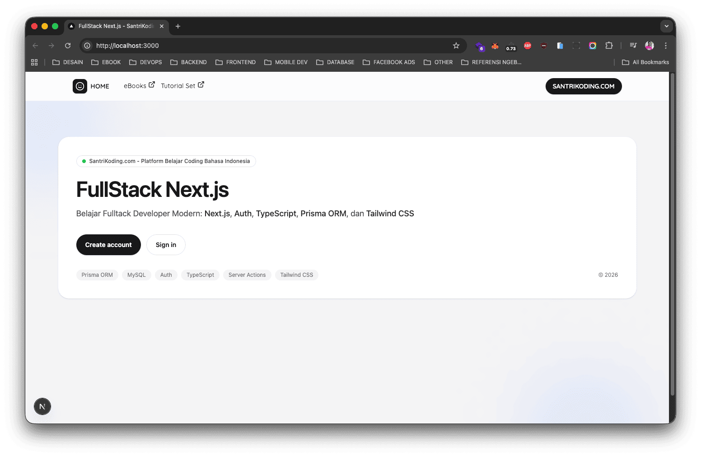
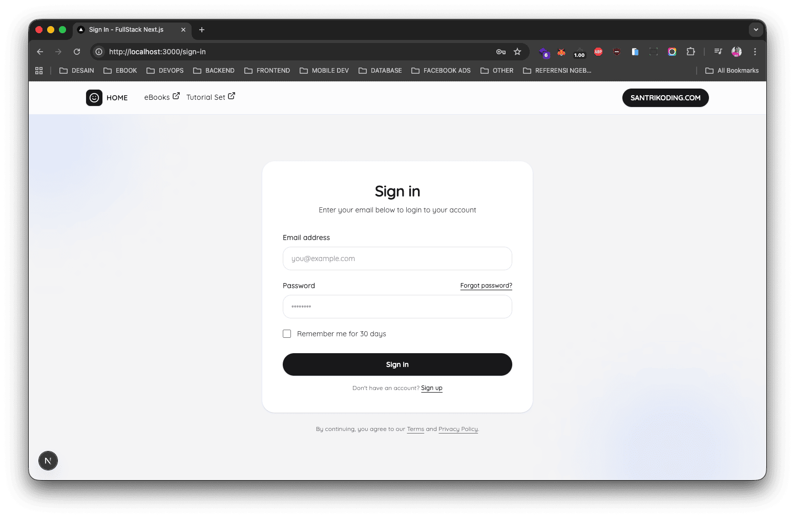
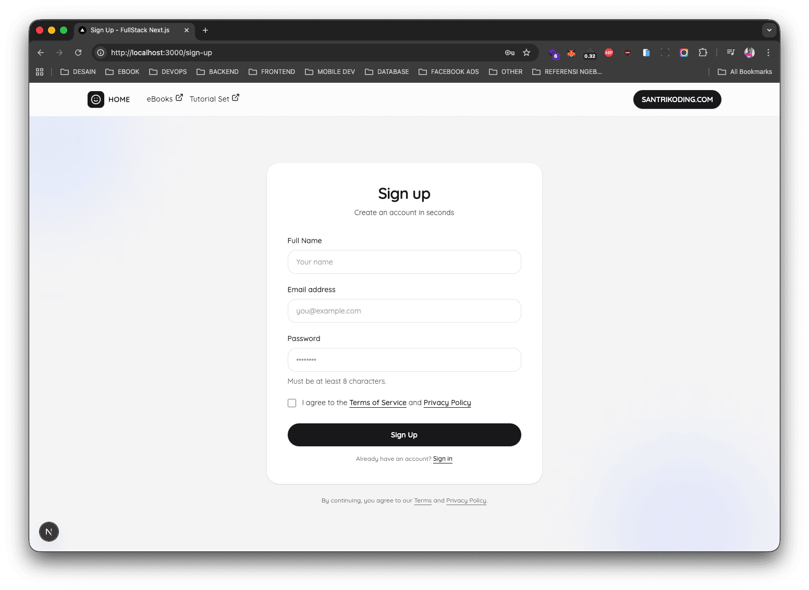
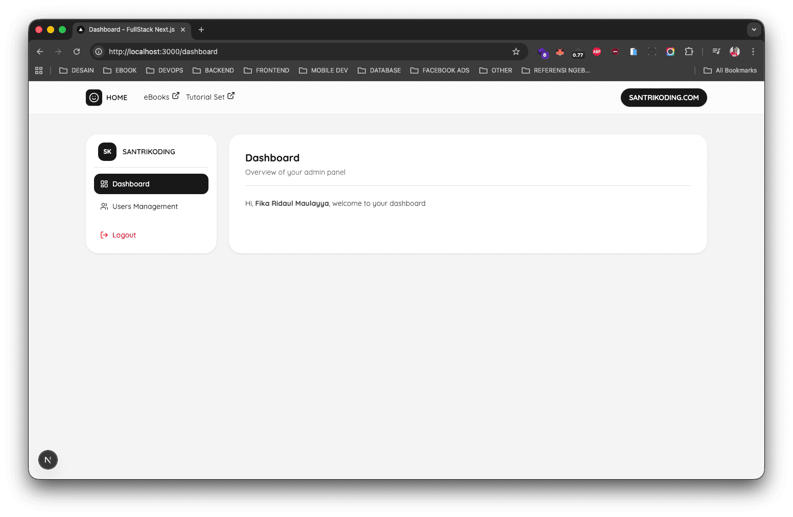
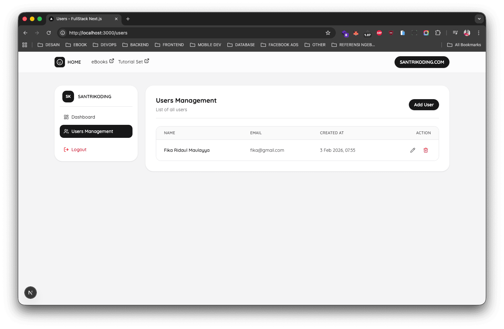
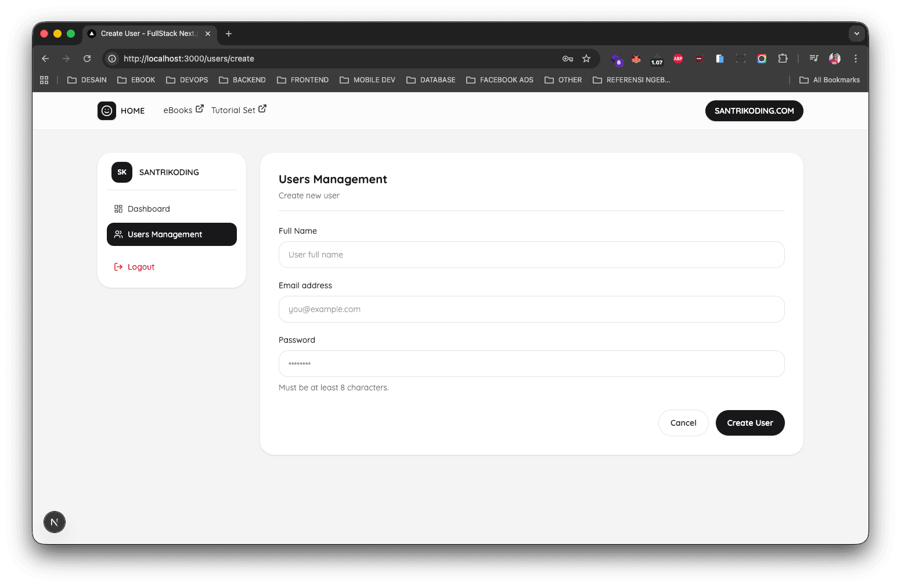
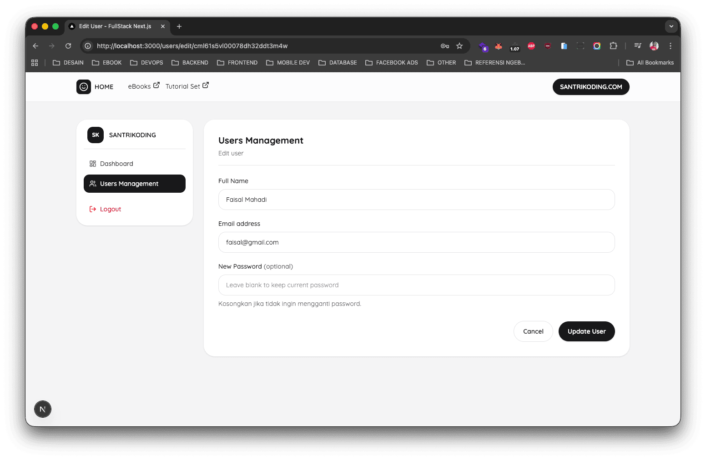

# Fullstack Next.js App Router – Admin Dashboard

Project ini adalah aplikasi **Fullstack Next.js** yang dibangun menggunakan **Next.js App Router**, dengan studi kasus **Admin Dashboard & User Management**.

Aplikasi ini memanfaatkan **Server Actions** sebagai pengganti REST API tradisional, sehingga alur data antara client dan server menjadi lebih sederhana, aman, dan terintegrasi langsung dengan Next.js.

Project ini dibuat sebagai **project pembelajaran** sekaligus **pendamping eBook Fullstack Next.js**, dengan fokus pada praktik nyata, struktur rapi, dan pola yang siap digunakan di production.

---

## Fitur Aplikasi

- Authentication (Sign Up, Sign In, Logout)
- Proteksi halaman menggunakan Auth Middleware
- Admin Dashboard
- Manajemen User (CRUD)
  - List Users
  - Create User
  - Edit User
  - Delete User
- Server Actions untuk proses data
- Validasi form menggunakan Zod
- Hashing password menggunakan Bcrypt
- Database management dengan Prisma ORM

---

## Teknologi yang Digunakan

- **Next.js (App Router)**
- **TypeScript**
- **Prisma ORM**
- **Zod**
- **bcryptjs**
- **Tailwind CSS**
- **Lucide Icons**

---

## 📁 Struktur Fitur Utama

```text
app/
 ├── (auth)/
 │   ├── sign-in/
 │   └── sign-up/
 ├── (admin)/
 │   ├── dashboard/
 │   └── users/
 │       ├── create/
 │       └── edit/
 └── actions/
     ├── auth/
     └── user/

components/
 ├── auth/
 ├── layout/
 ├── common/
 └── user/
 ```

### Cara Menjalankan Project
1. Clone Repository
   
    ```
    git clone https://github.com/SantriKoding-com/FullStack-Next.js
    ```

    ```
    cd FullStack-Next
    ```

2. Install Dependencies

    ```
    npm install
    ```

3. Setup Environment Variable

    Buat file `.env` di root project:

    ```
    DATABASE_URL="mysql://root:@localhost:3306/db_nextjs_fullstack"
    ```

    Sesuaikan dengan database yang kamu gunakan.

4. Jalankan Migration Database
    
    ```
    npx prisma migrate dev
    ```

5. Jalankan Development Server
   
    ```
    npm run dev
    ```


Akses aplikasi melalui browser:

http://localhost:3000

### Screenshot Aplikasi

Homepage


Sign In Page


Sign Up Page


Dashboard


Users Management


Create User


Edit User
